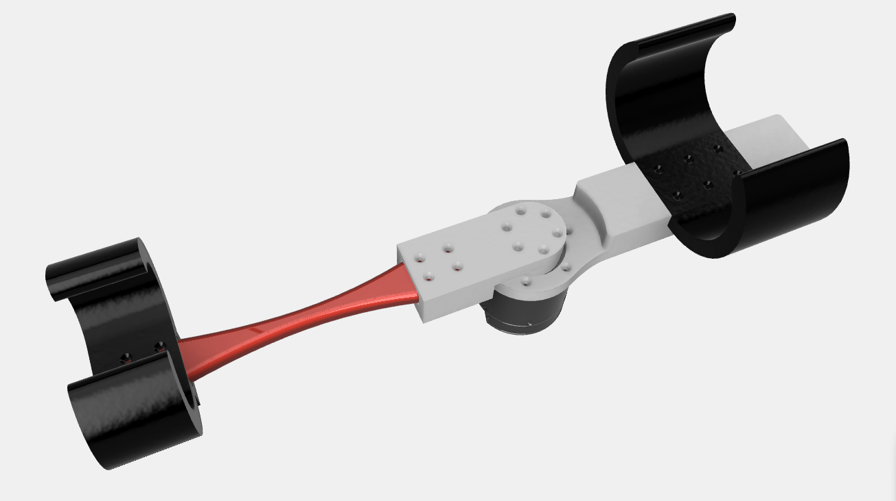
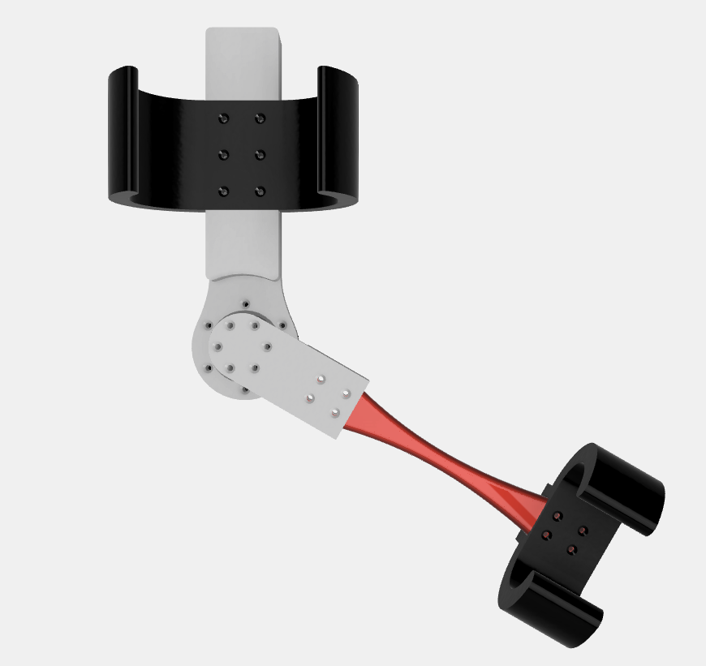
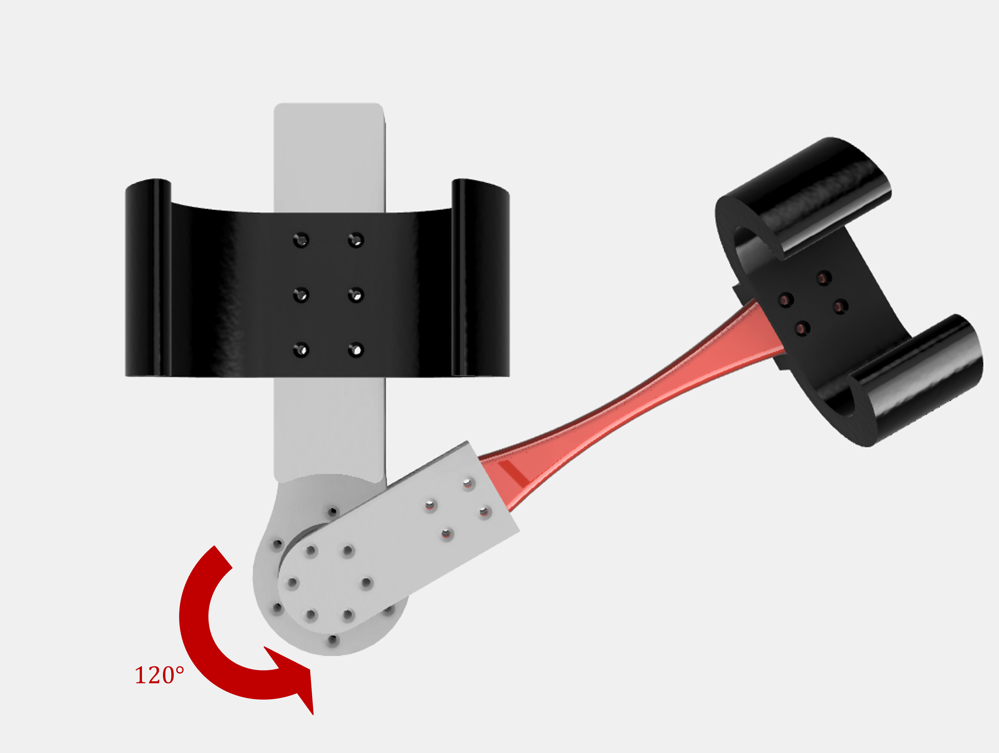

# Desenvolvimento, Controle e Simulação de um Exoesqueleto Robótico para Membros Superiores com Elo Elástico em Série e Controle H∞

Repositório associado ao projeto de pesquisa *"Desenvolvimento, Controle e Simulação de um Exoesqueleto Robótico para Membros Superiores com Elo Elástico em Série e Controle H∞"*, financiado pela Fundação de Amparo à Pesquisa do Estado de São Paulo (FAPESP), processo 2024/09583-3.

O projeto trata do desenvolvimento e da simulação de um exoesqueleto robótico de 1 grau de liberdade para reabilitação do movimento de flexão-extensão do cotovelo, com um elo elástico em série entre o atuador e o elo de saída e estratégias de controle baseadas em síntese H∞.

Este repositório disponibiliza:

- os códigos MATLAB de simulação e de projeto dos controladores;
- os controladores H∞ obtidos (contínuos e discretos);
- os resultados das simulações numéricas;
- o modelo CAD e imagens do protótipo físico.

---

## Sumário

1. [Objetivos](#objetivos)
2. [Sistema desenvolvido](#sistema-desenvolvido)
3. [Modelo matemático](#modelo-matemático)
4. [Estratégias de controle](#estratégias-de-controle)
5. [Estrutura do repositório](#estrutura-do-repositório)
6. [Requisitos](#requisitos)
7. [Como executar](#como-executar)
8. [Resultados](#resultados)
9. [Protótipo](#protótipo)
10. [Limitações conhecidas](#limitações-conhecidas)
11. [Como citar](#como-citar)
12. [Financiamento](#financiamento)

---

## Objetivos

- Desenvolver um modelo dinâmico de um exoesqueleto para reabilitação do cotovelo;
- incorporar um elemento elástico em série entre o atuador e o elo de saída;
- desenvolver estratégias de controle robusto baseadas em H∞;
- avaliar o comportamento do sistema sob diferentes estratégias de controle;
- analisar o desempenho de rastreamento de trajetória, sensibilidade e impedância;
- desenvolver e avaliar um protótipo físico do sistema.

## Sistema desenvolvido

O sistema possui um grau de liberdade, associado ao movimento de flexão-extensão do cotovelo. O modelo considera a dinâmica do atuador, o elo elástico e a interação com o membro superior.

- **Atuador de referência:** CubeMars AK45-36, com redução de 36:1.
- **Elo elástico:** representado por uma rigidez equivalente $K_s$, que modela a diferença entre a posição do motor e a posição do elo de saída.

```text
Referência
    │
    ▼
Controlador
    │
    ▼
Atuador ─── Elo elástico (Ks) ─── Membro superior
    │                                  │
    └─────────── realimentação ────────┘
```

## Modelo matemático

O modelo dinâmico utilizado nas simulações possui quatro estados:

$$
x =
\begin{bmatrix}
q_m & \dot{q}_m & q_l & \dot{q}_l
\end{bmatrix}^{T}
$$

onde:

- $q_m$ — posição angular do motor;
- $\dot{q}_m$ — velocidade angular do motor;
- $q_l$ — posição angular do elo de saída;
- $\dot{q}_l$ — velocidade angular do elo de saída.

A dinâmica considera a inércia do motor refletida pela transmissão, o amortecimento, a rigidez do elo elástico e o torque associado ao membro superior.

### Modelo utilizado na síntese H∞

O script `CODE_CONTROL_DESIGN/modelo_simulacao_G1_G2.m` constrói duas representações da dinâmica:

- **G1:** dinâmica principal do atuador;
- **G2:** efeito associado ao elo elástico em série.

Esses modelos são combinados para formar a planta usada no projeto dos controladores, realizado em `CODE_CONTROL_DESIGN/proj_hinf.m`.

## Estratégias de controle

Foram avaliadas quatro configurações:

| Configuração | Descrição |
|---|---|
| PD | Controlador PD convencional (não robusto), usado como referência |
| K1 | Controle de sensibilidade e robustez |
| K1 + K2 | Inclui K2, associado ao controle de impedância |
| K1 + K2 + K3 | Inclui K3, associado ao rastreamento da trajetória |

Os controladores K1, K2 e K3 foram obtidos por síntese H∞.

**Trajetória de referência:** sinal chirp com offset angular, o que permite avaliar o controlador em diferentes frequências.

**Métricas de desempenho:**

- erro RMS de rastreamento;
- erro máximo de rastreamento;
- torque máximo do atuador.

## Estrutura do repositório

```text
Elbow_Exoskeleton_Simulation/
│
├── README.md
│
├── CODE_SIMULATION/
│   ├── interface_elbow.m
│   ├── main_elbow.m
│   ├── elbow_model.m
│   ├── modelParameters_elbow.m
│   ├── anim_elbow_init.m
│   └── anim_elbow_meio.m
│
├── CODE_CONTROL_DESIGN/
│   ├── modelo_simulacao_G1_G2.m
│   └── proj_hinf.m
│
├── CONTROLLERS/
│   ├── controladores.mat
│   └── controladores_discretos.mat
│
├── RESULTS/
│   ├── PD_vs_K1/
│   ├── PD_vs_K1_uncertainty/
│   ├── K1_vs_K1K2/
│   └── K1K2_vs_K1K2K3/
│
├── PROTOTYPE_CAD/
│   └── exo_montagem.step
│
└── FIGURES_PROTOTYPE/
    ├── EXO_V2.png
    ├── EXO_V3.png
    └── EXO_V4_ANGULO.png
```

### `CODE_SIMULATION/`

Scripts de configuração, execução e visualização das simulações.

| Arquivo | Descrição |
|---|---|
| `interface_elbow.m` | Interface gráfica para configuração da simulação |
| `main_elbow.m` | Rotina principal de simulação |
| `elbow_model.m` | Modelo dinâmico do sistema |
| `modelParameters_elbow.m` | Parâmetros mecânicos e do atuador |
| `anim_elbow_init.m` | Inicialização da animação do movimento |
| `anim_elbow_meio.m` | Atualização da animação durante a simulação |

### `CODE_CONTROL_DESIGN/`

Scripts de modelagem para a síntese e de projeto dos controladores H∞.

| Arquivo | Descrição |
|---|---|
| `modelo_simulacao_G1_G2.m` | Construção dos modelos equivalentes G1 e G2 usados na síntese |
| `proj_hinf.m` | Projeto dos controladores H∞ K1, K2 e K3 |

### `CONTROLLERS/`

| Arquivo | Descrição |
|---|---|
| `controladores.mat` | Controladores H∞ contínuos, gerados por `proj_hinf.m` |
| `controladores_discretos.mat` | Controladores discretos, usados nas simulações |

### `RESULTS/`

Resultados das simulações numéricas para cada comparação entre estratégias (ver [Resultados](#resultados)). **São resultados de simulação, não dados experimentais.**

### `PROTOTYPE_CAD/`

`exo_montagem.step` — modelo CAD do protótipo em formato STEP, exportado do Fusion 360. Pode ser aberto em qualquer software CAD que leia STEP (Fusion 360, SolidWorks, FreeCAD etc.).

### `FIGURES_PROTOTYPE/`

Imagens de documentação do protótipo físico.

## Requisitos

- MATLAB
- Control System Toolbox (espaço de estados e funções de transferência)
- Robust Control Toolbox (síntese H∞)

## Como executar

### Simulação

1. Clone ou baixe este repositório:
   ```bash
   git clone https://github.com/Mepinheiro/Elbow_Exoskeleton_Simulation.git
   ```
2. Abra o MATLAB e adicione a pasta do projeto, com subpastas, ao path:
   ```matlab
   addpath(genpath('Elbow_Exoskeleton_Simulation'))
   ```
3. Confira se os arquivos da pasta `CONTROLLERS/` estão disponíveis.
4. Execute a interface gráfica:
   ```matlab
   interface_elbow
   ```
5. Configure os parâmetros do paciente e do robô, escolha o controlador (PD, K1, K1+K2 ou K1+K2+K3) e rode a simulação. A simulação é executada pela rotina `main_elbow.m`.

### Síntese dos controladores H∞

Para refazer a síntese dos controladores contínuos K1, K2 e K3:

```matlab
proj_hinf
```

## Resultados

| Pasta | Comparação |
|---|---|
| `RESULTS/PD_vs_K1/` | Controlador PD convencional × controlador robusto K1 |
| `RESULTS/PD_vs_K1_uncertainty/` | PD × K1 considerando incertezas nos parâmetros do sistema |
| `RESULTS/K1_vs_K1K2/` | Efeito da inclusão do controlador de impedância K2 |
| `RESULTS/K1K2_vs_K1K2K3/` | Efeito da inclusão do controlador de rastreamento K3 |

## Protótipo

O projeto inclui o desenvolvimento de um protótipo físico do exoesqueleto. O modelo CAD está em [`PROTOTYPE_CAD/`](PROTOTYPE_CAD/).

<table>
  <tr>
    <td align="center"><br><sub>Vista frontal</sub></td>
    <td align="center"><br><sub>Vista lateral</sub></td>
    <td align="center"><br><sub>Vista em ângulo</sub></td>
  </tr>
</table>

## Limitações conhecidas

- **Discretização:** o procedimento original de discretização dos controladores não está neste repositório. Os controladores discretos usados nas simulações estão em `CONTROLLERS/controladores_discretos.mat`, mas essa etapa não pode ser reproduzida a partir dos scripts.
- **Resultados:** todos os resultados disponibilizados são de simulação numérica.

## Como citar

Se este repositório for útil para o seu trabalho, cite:

> PINHEIRO, Maria Eduarda Almeida. *Desenvolvimento, Controle e Simulação de um Exoesqueleto Robótico para Membros Superiores com Elo Elástico em Série e Controle H∞*. Dissertação (Mestrado em Engenharia Elétrica) — Universidade Estadual Paulista (Unesp), 2026.

```bibtex
@mastersthesis{pinheiro2026exoesqueleto,
  author = {Pinheiro, Maria Eduarda Almeida},
  title  = {Desenvolvimento, Controle e Simula{\c{c}}{\~a}o de um Exoesqueleto Rob{\'o}tico para Membros Superiores com Elo El{\'a}stico em S{\'e}rie e Controle {H$_\infty$}},
  school = {Universidade Estadual Paulista (Unesp)},
  year   = {2026},
  type   = {Disserta{\c{c}}{\~a}o de Mestrado}
}
```

## Financiamento

Este trabalho foi desenvolvido com apoio da Fundação de Amparo à Pesquisa do Estado de São Paulo (FAPESP), processo 2024/09583-3.
